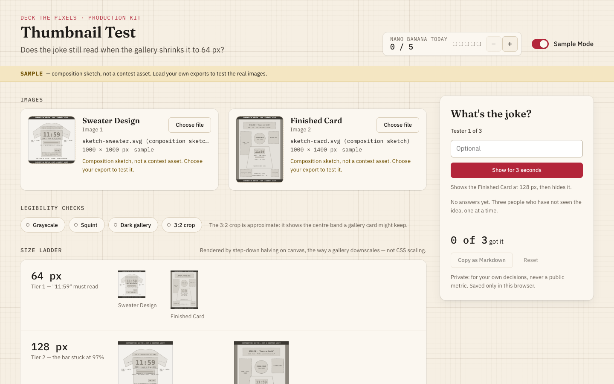
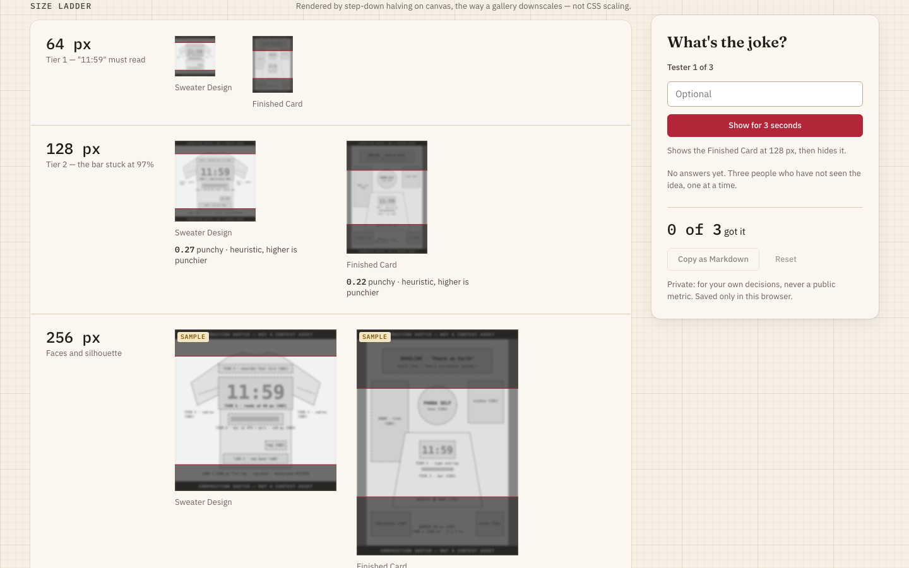
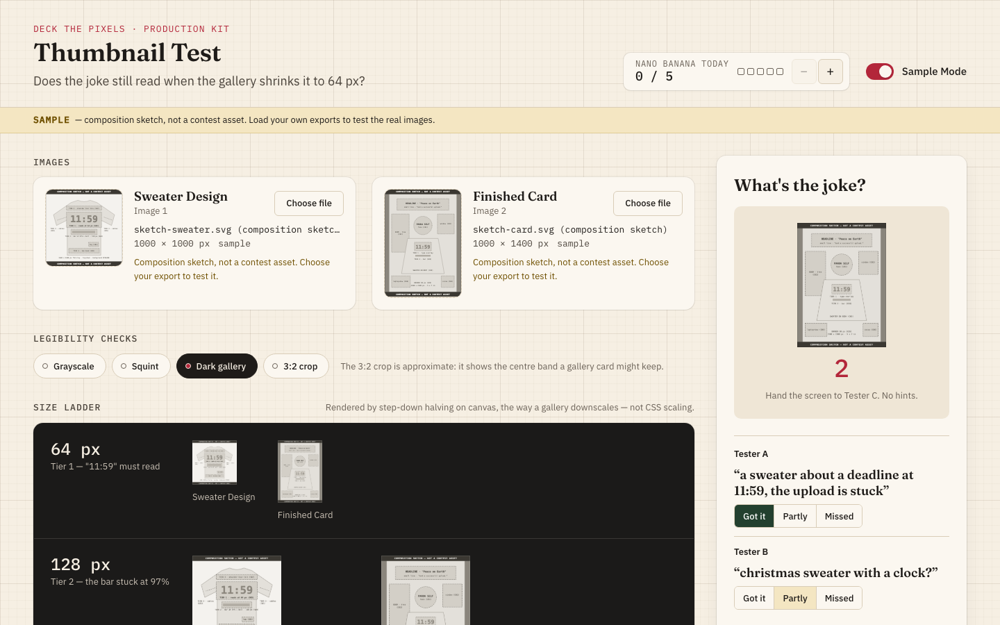
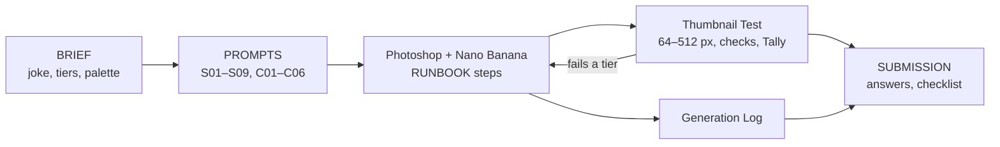

# The 11:59 Sweater — Deck the Pixels production kit

**Peace on Earth, and a successful upload.** A production kit for one entry to Deck the Pixels
(Google + Adobe on Devpost): a calm, wholesome holiday card of the entrant as their messy brown panda
self, wearing an ugly knitted sweater that celebrates the worst minute of finals season, **11:59 PM**,
upload frozen at 97%.



> **This repository does not contain the contest images.** Every contest image is made by the entrant
> in Adobe Photoshop with Nano Banana selected as the Generative Fill model. The repo holds the plan
> for making them (brief, prompts, Photoshop runbook, submission drafts) and a small local web tool
> that checks whether the images still read at thumbnail size. All pictures in this repo are labelled
> composition sketches or screenshots of the tool.

## The problem

One student, finals season, a free Photoshop web account with **5 generations per day**, and 17 days
to the deadline. The sweater joke needs to read in a small gallery preview, which the tool approximates
at 128 px wide. Spending a scarce
generation on an improvised prompt, or finding out on deadline day that "11:59" turns into mush at
thumbnail size, costs time. [Official contest rules](https://deckthepixels.devpost.com/rules)

## What it does

| Part | What it gives the owner |
|---|---|
| [docs/BRIEF.md](docs/BRIEF.md) | The joke in one sentence, the three-tier Joke Hierarchy with Read Sizes, palette with measured contrast, motif list with banned variants, type rules |
| [docs/PROMPTS.md](docs/PROMPTS.md) | 15 finished Generative Fill prompts (S01–S09 sweater, C01–C06 card), each with selection size, variants, keep/reject rules and budget; the day-by-day Generation Budget calendar; a "when a generation fails" table |
| [docs/RUNBOOK.md](docs/RUNBOOK.md) | Numbered Photoshop steps with exact layer names: the type-to-knit pass, annotation prompting, the Reference Layer technique, export and the Layers Screenshot recipe |
| [docs/SUBMISSION.md](docs/SUBMISSION.md) | Title, tagline, Written Answer templates with `[[PLACEHOLDER]]`s, a Top Banana technique paragraph, the final checklist and a rules compliance table |
| [docs/GEN_LOG.md](docs/GEN_LOG.md) | The Generation Log the Written Answers are built from |
| [docs/images/sketch-*.svg](docs/images/) | Composition Sketches: grey wireframes of where each tier sits. Not contest assets |
| [tools/thumbnail-test/](tools/thumbnail-test/) | The **Thumbnail Test**: a local tool that shows both images at 64/128/256/512 px with legibility checks, a 3-person joke Tally and the daily budget counter |

## The demo moment

Drop the exported Sweater Design into the Thumbnail Test and look at the **64 px** rung. If "11:59"
still reads there, tier 1 of the joke survives the gallery. Turn on **Grayscale** and **Squint** to see
if the digits still separate from the red wool. Press **Show for 3 seconds** as you hand the screen
to a friend. A dialog covers the ladder and shows the Finished Card at 128 px, or the Sweater Design
if you’ve only loaded that export. When the thumbnail disappears, type what your friend saw.

| Grayscale + squint + approximate 3:2 crop | Three-person Tally |
|---|---|
|  |  |

These screenshots show an earlier build in Sample Mode. The Tally answers were entered to illustrate the controls.

## How it works



The sweater is finished and locked first, then copied into the card as a Reference Layer
([ADR 0001](docs/adr/0001-lock-sweater-before-card.md)), so the two images match.

## Sponsor tech and why it is necessary

**Nano Banana in Photoshop Generative Fill** is the only image generator the entry uses: the rules
require it, and the kit is built around what it does well and badly.

- **Reference Layer.** Partner models see only the pixels inside the selection, so the approved sweater
  is placed inside the card canvas beside the portrait and selected together with it: "dress the person
  on the left in exactly the sweater shown on the right". The reference is then hidden and cropped away.
- **Annotation prompting.** Red guide lines on a notes layer say exactly where the sleeve cables go; the
  prompt ends "Remove the red lines when done."
- **Type-to-knit pass.** Model-drawn text is unreliable, so "11:59" is real type, rasterised, padded
  150 px and knitted by Nano Banana with "keep these exact shapes". The live type stays hidden in the file
  as proof.
- **Budget-shaped plan.** Five generations a day means every prompt is finished in advance and every
  generation is logged; the Thumbnail Test catches thumbnail failures before more budget is spent.

## Quickstart

Requires Node 22.

```bash
npm install
npm run dev        # Thumbnail Test at http://localhost:5179
```

Other scripts: `npm test` (Vitest), `npm run typecheck`, `npm run build` (static build in `dist/`).

## Sample mode vs real images

| | Sample Mode (default on first visit) | Real images |
|---|---|---|
| What loads | The two Composition Sketches, with a "Sample" ribbon and badges | Your exported PNG/JPEG, chosen or dropped per slot |
| Validation | Skipped (they are sketches) | Type, size (> 5 MB warning), pixel size, 1:1 and 5:7 aspect |
| Switching modes | Turning Sample Mode off restores any exports you loaded in this tab | Loading any real image switches Sample Mode off |
| Tally | Practice answers stay in this tab | Recorded answers can be copied as Markdown |

After setup, the tool runs locally without a key, account or network connection. Images stay in the
browser tab. The Tally for your exports, the budget counter and the Sample Mode preference use localStorage.

## Judging criteria → where to see proof

| Criterion | Where to look |
|---|---|
| Technological implementation | The three Nano Banana techniques in [RUNBOOK](docs/RUNBOOK.md#c03-dress--the-reference-layer-technique) and [PROMPTS](docs/PROMPTS.md); the Layers Screenshot recipe that shows them in the submitted file |
| Innovation / idea | The joke and its tiered Read Sizes in [BRIEF](docs/BRIEF.md); the sincere card frame with the punchline on the sweater |
| Design | Palette and contrast rule in [BRIEF](docs/BRIEF.md#palette); the [Composition Sketches](docs/images/sketch-sweater.svg); the Thumbnail Test for checking the final exports |
| Rules compliance | [SUBMISSION — rules compliance](docs/SUBMISSION.md#rules-compliance) |

The Tally session module (`tools/thumbnail-test/src/lib/tallySession.ts`) owns reveal timing,
cancellation, practice isolation, revision restoration, persistence and export metadata. The DOM
provides browser storage and clock adapters and renders the session. Lifecycle tests use that same
interface; DOM regressions cover asynchronous image replacement, focus and the completed Tally selector.

## Project structure

```
.
├─ docs/
│  ├─ BRIEF.md  PROMPTS.md  RUNBOOK.md  SUBMISSION.md  GEN_LOG.md
│  ├─ GRILL.md  RESEARCH.md  PLAN.md  adr/      planning record
│  └─ images/                      composition sketches + tool screenshots
├─ tools/thumbnail-test/
│  ├─ index.html
│  ├─ public/samples/              copies of the composition sketches
│  └─ src/
│     ├─ lib/   validate · ladder · contrast · tally · budget (+ *.test.ts)
│     └─ ui/    intake · ladder · checks · tally · budget · sample
├─ GLOSSARY.md
└─ package.json  vite.config.ts  tsconfig.json
```

## Known limitations

- **No contest images in the repo**, by design. `work/`, `*.psd` and `exports/` are git-ignored.
- Photoshop details that could not be confirmed are marked **Verify** in the docs: which Gemini versions
  the free web tier offers, whether the model name shows in the Properties panel, the trial's credit cost,
  Content Credentials on web exports, and the Devpost upload size limit. Confirmed from the official rules
  page (read 2026-11-18): the 5-per-day free limit, and that Nano Banana is used by selecting it as the
  Generative Fill model.
- The 3:2 crop overlay is an approximation of gallery cards, not Devpost's exact crop.
- The RMS contrast number is a heuristic (higher is punchier), not a WCAG ratio.
- Thumbnails are drawn at 1 canvas pixel per CSS pixel, so on high-DPI screens they look slightly softer
  than a gallery would show them: a deliberately pessimistic test.

## How this was built

The kit (planning documents, prompts, runbook, submission templates and the Thumbnail Test code) was
planned and written with the help of an AI coding assistant. The contest images themselves are made by
the entrant in Adobe Photoshop with Nano Banana, and are not part of this repository.

## License

MIT. See [LICENSE](LICENSE).

### Revision-aware review

The story is “one stitch from submitted”: 11:59, an almost-finished knit bar, live loops and a loose yarn
tail, worn with complete sincerity in a quiet holiday portrait. The SVGs remain placement sketches, not
AI-generated contest art or Photoshop evidence.

Choose the sweater or card before each three-second blind test. Actual file bytes are SHA-256 hashed
locally; feedback is restored only for the same subject and digest. Filenames alone never identify a
revision. Export JSON to keep the revision metadata and responses together. Browser storage is optional;
when blocked, export before closing the tab. Old v1 answers remain untouched as an unbound archive and
are never counted as evidence for a new image. Samples have separate, ephemeral practice responses.

The side-by-side checklist is manual, resets when an image changes, and offers no AI similarity score.
Readiness reports actual export file checks; it cannot certify the joke, likeness, Photoshop layers or
contest eligibility. No image is uploaded, no account or key is required, and no contest artwork is claimed.

Before generating texture or decoration, use the [thumbnail scale gate](docs/RUNBOOK.md#thumbnail-scale-gate-before-decoration). A literal 3% bar gap is only 1.76 px on the 128 px sweater thumbnail, and smaller in the portrait. The projecting yarn tail carries the unfinished silhouette; needle loops and the exact percentage are close-view details. Rough type and crop exports can catch this failure without spending a generation. No actual image legibility has been validated yet.
